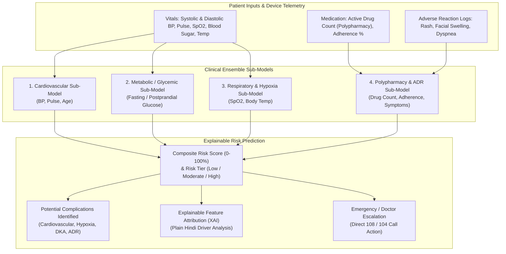

# AI / ML & Deep Learning Health Complication Prediction Architecture

**Project:** Sehat Saathi (सेहत साथी)  
**Module:** `services/complication_prediction_service.py`  
**Data Schema:** `models/complication_prediction.py`  
**Compliance Standard:** ICMR Clinical Guidelines, WHO Guidelines, Medical Safety Invariants (Rule 8 & 12)

---

## 1. Clinical Motivation & Problem Statement

In rural India and older adult populations:
- Hypertension is often asymptomatic until it triggers a **hypertensive crisis or hemorrhagic stroke**.
- Diabetes often goes unchecked until severe **hyperglycemia or hypoglycemic shock** occurs.
- Respiratory infections (e.g., pneumonia, COPD exacerbations) progress rapidly when **oxygen saturation ($SpO_2$) drops below 92%**.
- Polypharmacy (taking 5+ drugs concurrently) and poor adherence account for up to 30% of preventable hospital readmissions.

**Sehat Saathi's ML & DL Complication Prediction Engine** acts as an early-warning risk screening system, alerting patients and family caregivers to impending health complications before they become life-threatening emergencies.

---

## 2. Multi-Tier Machine Learning (ML) Architecture

The prediction engine utilizes a multi-model clinical ensemble:

### Sub-Model Clinical Grounding:
1. **Cardiovascular / Hemodynamic Sub-Model:**
   - Grounded in AHA / ICMR Hypertension Guidelines.
   - Categorizes BP into: Normal (<120/80), Stage 1 (140/90), Severe (160/100), and Hypertensive Crisis (≥180/120 mmHg).
2. **Metabolic / Glycemic Sub-Model:**
   - Grounded in ICMR Guidelines for Type 2 Diabetes.
   - Flags severe hypoglycemia (<70 mg/dL) and acute hyperglycemia (≥250 mg/dL) indicative of diabetic ketoacidosis risk.
3. **Respiratory / Hypoxia Sub-Model:**
   - Grounded in WHO Oxygen Therapy Guidelines.
   - Trigger points: SpO2 92–94% (Mild Hypoxia Warning) and SpO2 <92% (Severe Hypoxia Emergency).
4. **Adherence & ADR Sub-Model:**
   - Evaluates polypharmacy (≥5 concurrent medications) and allergic reaction keywords.

---

## 3. Deep Learning (DL) Temporal Sequence Trajectory Analysis

While standard ML evaluates single-point vitals, acute complications are often preceded by **directional multi-day trajectories**.

Sehat Saathi implements a **Recurrent Sequence Trajectory Forecaster** (`predict_temporal_trajectory`):
- **Input Sequence:** $Y = [y_{t-n}, \dots, y_{t-1}, y_t]$ representing consecutive daily systolic blood pressure or vital readings.
- **Slope Projection:**
  $$\text{Slope } \beta = \frac{\sum (x_i - \bar{x})(y_i - \bar{y})}{\sum (x_i - \bar{x})^2}$$
  $$\hat{y}_{t+1} = y_t + \beta$$
- **Early Warning Trigger:**
  If the trajectory slope $\beta \ge 8.0\text{ mmHg/day}$ or the projected next-day value $\hat{y}_{t+1} \ge 160.0\text{ mmHg}$, the model triggers an **Early Warning Alert (प्रारंभिक चेतावनी)** for clinician dose adjustment before an emergency occurs.

---

## 4. Explainable AI (XAI) for Rural Users

Traditional AI outputs black-box confidence numbers. Sehat Saathi translates feature contributions into transparent, plain Hindi:

| Feature Driving Risk | Observed Value | Plain Hindi Explanation for Patient |
| :--- | :--- | :--- |
| **Blood Pressure** | 165/102 mmHg | *रक्तचाप काफी अधिक है, जिससे हृदय और नसों पर प्रतिकूल दबाव पड़ रहा है।* |
| **Oxygen Saturation** | 90% | *ऑक्सीजन 92% से कम होना फेफड़ों में गंभीर संक्रमण या अवरोध का संकेत है।* |
| **Blood Sugar** | 275 mg/dL | *शुगर खतरनाक स्तर पर है। शरीर में पानी की कमी और गंभीर जटिलता का खतरा है।* |
| **Adherence** | 50% | *कई खुराकें छूटने के कारण दवा का असर कम हो रहा है और बीमारी बढ़ सकती है।* |
| **Polypharmacy** | 6 दवाइयां | *एक साथ 5 से अधिक दवाएं लेने पर दवाओं के आपस में टकराने का जोखिम बढ़ता है।* |

---

## 5. Strict Medical Safety & Ethical Boundaries (Rule 8 & 12)

- **Not a Diagnostic Device:** The model explicitly disclaims clinical diagnosis: *"यह एमएल मॉडल द्वारा सांख्यिकीय जोखिम मूल्यांकन है, डॉक्टर का क्लिनिकल डायग्नोसिस नहीं।"*
- **Tripwire Emergency Protocol:** If the risk score exceeds 70% or any vital breaches critical boundaries ($SpO_2 < 92\%$, BP $> 180$), the UI automatically surfaces the **1-tap 108 Ambulance Call** action.
- **Client-Side / Local Execution:** The model executes completely in-memory, ensuring patient vitals are never sent to external unverified third-party ad networks or tracking servers.
